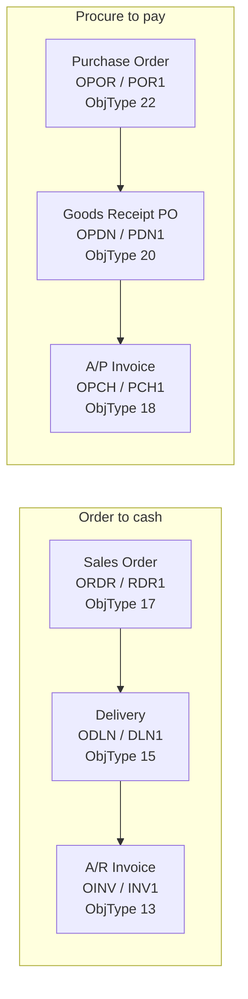
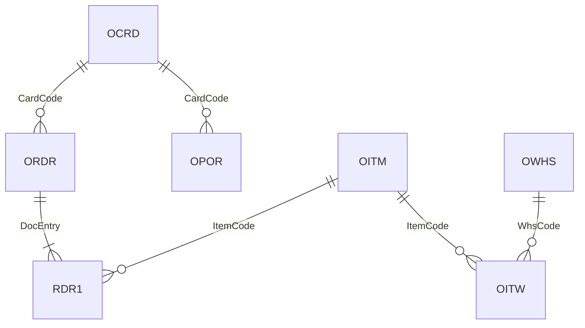

# Data model

The tables follow the SAP Business One layout, reduced to the columns this project uses.

## Document flow

Every marketing document has a header table (`O…`) and a line table (`…1`).
A follow-up document copies lines from its source and records the link on each line.



The link lives on the line of the follow-up document:

| Column | Meaning |
|---|---|
| `BaseType` | Object type of the source document (17 = sales order, 15 = delivery, 22 = PO, 20 = goods receipt PO). `-1` = no source. |
| `BaseEntry` | `DocEntry` of the source document |
| `BaseLine` | `LineNum` of the source line |

So "which invoice line came from this order line?" is two joins:

```sql
RDR1 r
LEFT JOIN DLN1 dl ON dl.BaseType = 17 AND dl.BaseEntry = r.DocEntry AND dl.BaseLine = r.LineNum
LEFT JOIN INV1 il ON il.BaseType = 15 AND il.BaseEntry = dl.DocEntry AND il.BaseLine = dl.LineNum
```

## DocEntry vs DocNum

- `DocEntry` is the internal key. Joins always use it.
- `DocNum` is the number users see on screen and on printed documents. It can come from different numbering series.

## Master data



| Table | Content |
|---|---|
| `OCRD` | Business partners. `CardType` C = customer, S = supplier. `frozenFor` = blocked. |
| `OITM` | Items, with a minimum stock level (`MinLevel`). |
| `OWHS` | Warehouses. `03` is quarantine and doesn't count as usable stock. |
| `OITW` | Stock per item and warehouse: on hand, committed to sales orders, on order from suppliers. |

## SQLite vs SQL Server

B1 runs on Microsoft SQL Server or SAP HANA. This project uses SQLite so it runs anywhere with no setup. The SQL is kept close to T-SQL; the differences that show up here:

| SQLite (this repo) | T-SQL (SQL Server) |
|---|---|
| `... LIMIT 10` | `SELECT TOP 10 ...` |
| `date(RefDate, '-90 days')` | `DATEADD(day, -90, GETDATE())` |
| `julianday(b) - julianday(a)` | `DATEDIFF(day, a, b)` |
| `strftime('%Y-%m', DocDate)` | `FORMAT(DocDate, 'yyyy-MM')` |
| `GROUP_CONCAT(x, ', ')` | `STRING_AGG(x, ', ')` |

The analysis date is fixed in `REF_DATE` so results stay reproducible; in a live system it would be `GETDATE()`.
